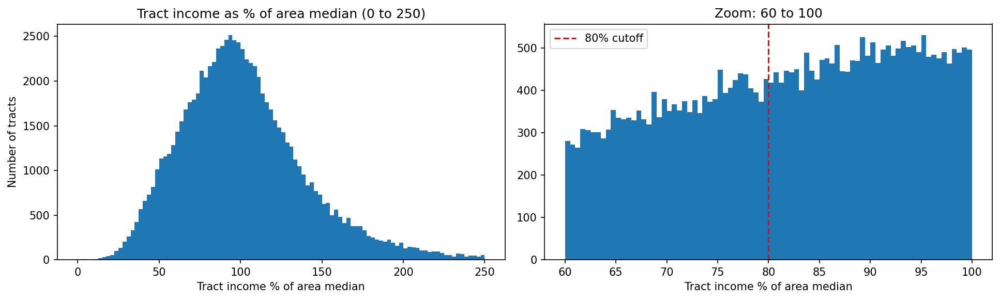
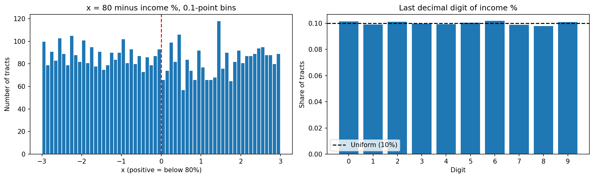
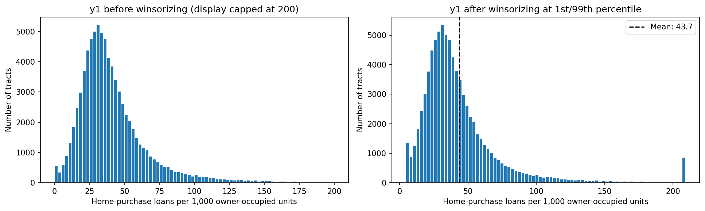
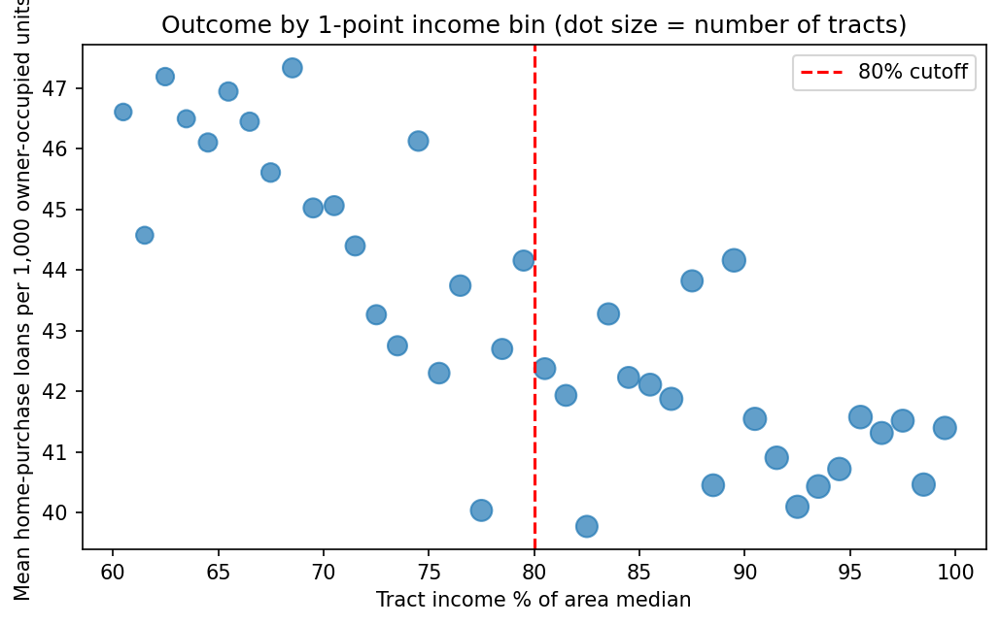
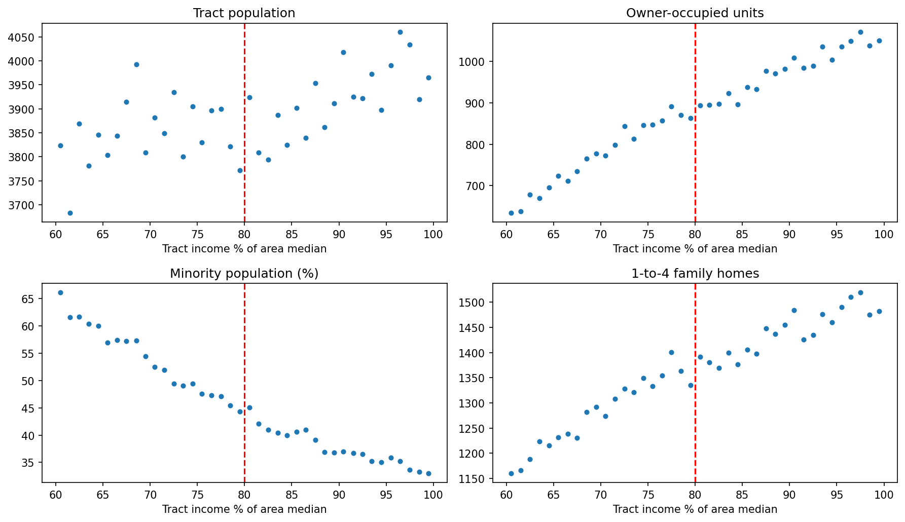
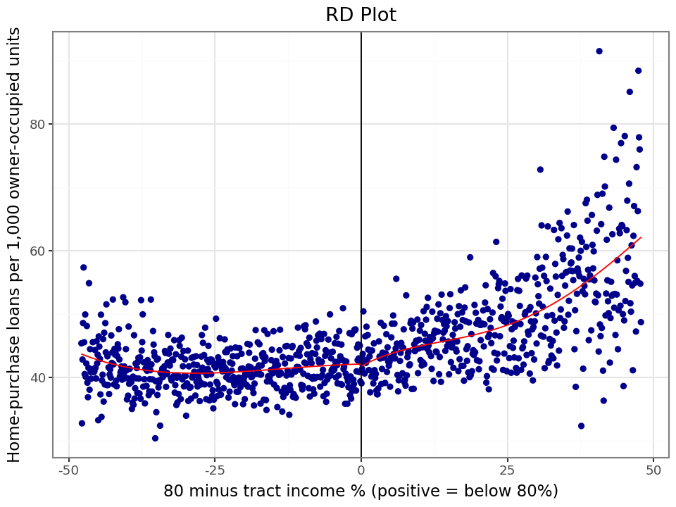
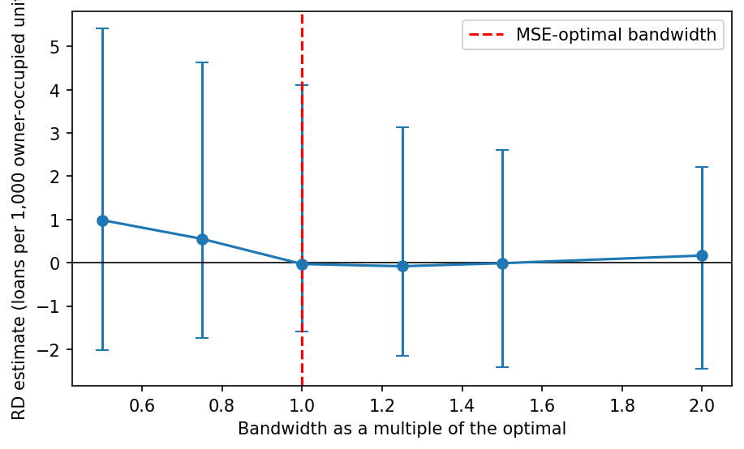
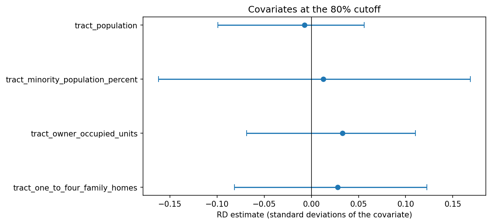
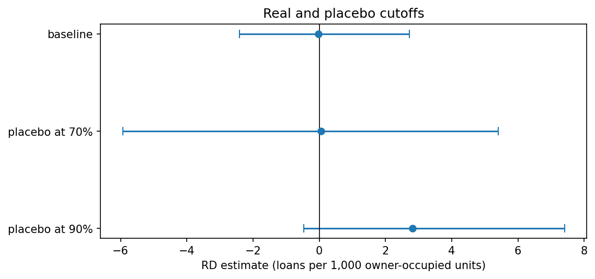
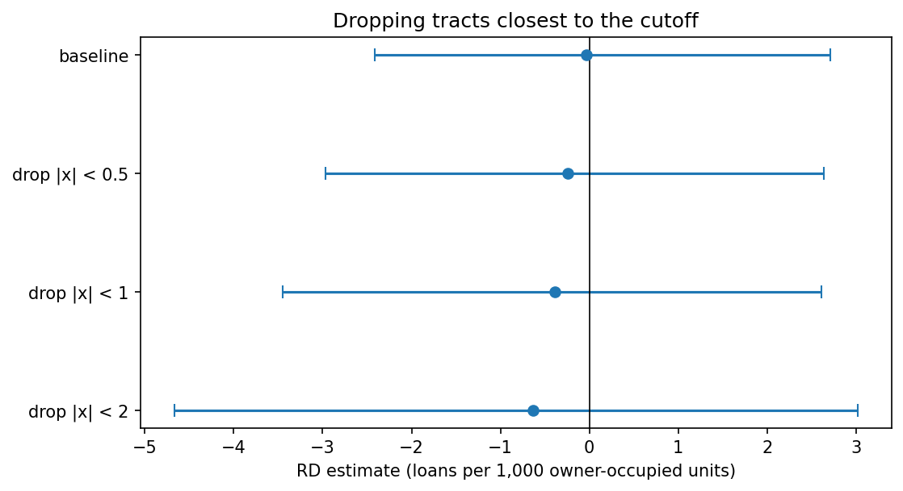

# Regression Discontinuity Analysis of the CRA 80% Tract-Income Threshold and Mortgage Lending

An independent Python analysis of whether the Community Reinvestment Act (CRA) low- and moderate-income label, assigned to census tracts below 80% of area median family income, produces a discontinuous change in home-purchase mortgage lending. The project builds a tract-level dataset from 2023 HMDA loan-level data and the FFIEC census file, checks the assumptions behind a regression discontinuity design (RDD), estimates the effect on three lending outcomes, and stress-tests the result with placebo cutoffs, alternative specifications and a bank versus non-bank split.

## Research Question

Does crossing the 80% income threshold that defines low- and moderate-income (LMI) census tracts change mortgage lending, and how far can this result be read as an effect of the CRA?

The project does not assume the threshold assigns individual mortgage applications to a treatment. It tests whether the tract's income label is associated with a discontinuous change in lending.

| Outcome | Definition |
|---|---|
| `y1` (main) | Home-purchase originations per 1,000 owner-occupied units |
| `y2` | Log of total originated home-purchase dollars |
| `y3` | Denial rate on home-purchase applications that reached a decision |

**Headline result:** the estimated effect on `y1` is -0.03 loans per 1,000 owner-occupied units (95% CI -2.42 to 2.72) against a mean of 41.7 just above the cutoff. No effect is detected, and effects larger than about 6% of average lending are ruled out.

## Data

| Item | Description |
|---|---|
| Lending data | 2023 HMDA Loan Application Register (one-year public file) |
| Lender data | 2023 HMDA Transmittal Sheet (regulator code for each lender) |
| Tract data | 2023 FFIEC Census Flat File (tract income as % of area median, official income level) |
| Unit of analysis | U.S. census tract |
| Bandwidth sample | About 15,073 tracts at or above 80% and 11,882 below (baseline bandwidth) |

Sources:

- HMDA: https://ffiec.cfpb.gov/data-publication/
- FFIEC census flat file: https://www.ffiec.gov/geocode/default.htm

Construction steps:

- The loan-level file is processed in chunks and collapsed to one row per tract, using home-purchase loans (`loan_purpose == 1`) for outcomes.
- Tract covariates (population, minority share, owner-occupied units, 1-to-4 family homes) come from the HMDA file.
- The FFIEC file is merged on the 11-digit tract identifier, and tracts without owner-occupied units are dropped because they have no denominator.
- Tracts with no loans are kept as zeros.
- The code asserts that tract IDs are unique, that the treatment indicator agrees with the official FFIEC classification (zero mismatches), and that more than 50,000 tracts remain.

The number of tracts near the cutoff:

| Window around 80% | Tracts | Below 80% | At or above 80% |
|---|---|---|---|
| ±1 point | 1,671 | 800 | 871 |
| ±2 points | 3,333 | 1,600 | 1,733 |
| ±5 points | 8,541 | 4,151 | 4,390 |

## Exploratory Analysis



*Figure 1. Tract income as a percentage of area median (left) and a zoom on 60 to 100% (right). The distribution is smooth through the 80% cutoff, with no visible jump or spike.*



*Figure 2. Tracts in 0.1-point bins around the cutoff (left) and the last decimal digit of the income percentage (right). Counts stay between roughly 60 and 120 on both sides with no pile-up at zero. A mild dip just right of the line and a spike near 1.5 look like noise. Every digit is close to 10%, so there is no rounding.*



*Figure 3. Home-purchase loans per 1,000 owner-occupied units before (left) and after (right) winsorizing at the 1st and 99th percentiles. The spike near 4.5 is 433 zero-loan tracts lifted to the lower cap, and the spike near 209 is 904 extreme tracts capped at the upper limit. The mean after winsorizing is 43.7.*



*Figure 4. Mean outcome in 1-point income bins (dot size is the number of tracts). Lending falls with income, from about 47 at 60% to about 41 at 100%, and shows no clear jump at 80%.*



*Figure 5. Tract characteristics in 1-point income bins. Three trend smoothly with income and population scatters around a flat level. None shows a jump at 80%.*

The formal density test is not yet run (see Limitations). The histograms support the design but do not replace it.

## Methodology

### Running variable and treatment

Let  be tract *i*'s median family income as a percentage of its area median. The running variable and treatment are:

<p align="center">
  
</p>

<p align="center">
  
</p>

Positive *x* means the tract is below 80% (LMI). Tracts exactly at 80 are placed on the control side by subtracting 1e-6 from *x*.

### Outcomes

Let  be home-purchase originations,  applications reaching a decision (originated, approved but not accepted, or denied),  denials,  owner-occupied units and  total originated dollars.

<p align="center">
  
</p>

<p align="center">
  
</p>

<p align="center">
  
</p>

*winsor* caps values at the 1st and 99th percentiles. The uncapped version of `y1` is reported as a robustness check.

### Estimand and estimator

The effect of being below the cutoff, at the cutoff:

<p align="center">
  
</p>

It is estimated by local linear regression with a triangular kernel, using the `rdrobust` package:

<p align="center">
  
</p>

<p align="center">
  
</p>

| Setting | Choice |
|---|---|
| Polynomial order | 1 (order 2 as a check) |
| Kernel | Triangular (uniform as a check) |
| Bandwidth | MSE-optimal, one common bandwidth for both sides |
| Standard errors | Clustered by county (5-digit FIPS) |
| Inference | Robust bias-corrected 95% confidence interval |

### Effect size scaling

<p align="center">
  
</p>

<p align="center">
  
</p>

The control mean uses tracts at or above 80% within the bandwidth. Extra dollars per tract multiply extra loans by the average originated loan size in the control group.

### Covariate balance

Each covariate *Z* is standardized so estimates are comparable, then used as the outcome in the same RD:

<p align="center">
  
</p>

### Bank versus other lenders

Banks are identified by the regulator in the HMDA transmittal sheet (OCC, FRB or FDIC filers). All other filers, including credit unions and non-bank lenders, are grouped as "other". Outcomes are originations per 1,000 owner-occupied units for each group.

## Results

### Baseline RD estimate



*Figure 6. Local averages of the outcome against 80 minus tract income, with a smooth curve fitted on each side. The curves meet at the cutoff with no visible jump. The rise in lending further below 80% is a general pattern linked to lower incomes and is smooth through the cutoff.*

| Quantity | Value |
|---|---|
| RD estimate (loans per 1,000 owner-occupied units) | -0.03 |
| 95% robust CI | [-2.42, 2.72] |
| MSE-optimal bandwidth | 15.96 income points |
| Tracts used (at or above 80%, below 80%) | 15,073 and 11,882 |
| Mean just above the cutoff | 41.66 |
| Estimate as % of control mean | -0.07% |
| Extra loans per tract | -0.03 |
| Average loan size | $305,721 |
| Extra dollars lent per tract | -$8,080 |

The interval is about -5.8% to +6.5% of the control mean.

### Sensitivity to bandwidth



*Figure 7. RD estimate at multiples of the optimal bandwidth, with 95% intervals. The estimate is about +1.0 at half the bandwidth and stays near zero at wider bandwidths. Every interval includes zero.*

| Bandwidth multiple | h | Estimate | 95% CI | N (at or above, below) |
|---|---|---|---|---|
| 0.5x | 7.98 | 0.99 | [-2.01, 5.41] | 7,162 / 6,340 |
| 0.75x | 11.97 | 0.55 | [-1.74, 4.63] | 11,078 / 9,211 |
| 1.0x | 15.96 | -0.03 | [-1.59, 4.10] | 15,073 / 11,882 |
| 1.25x | 19.95 | -0.08 | [-2.15, 3.14] | 18,949 / 14,204 |
| 1.5x | 23.94 | -0.01 | [-2.40, 2.61] | 22,686 / 16,197 |
| 2.0x | 31.91 | 0.17 | [-2.45, 2.21] | 29,540 / 19,795 |

The 1.0x interval differs from the baseline interval because `rdrobust` sets a different bias bandwidth when the bandwidth is passed by hand. The baseline table is the headline result.

### Covariate balance



*Figure 8. RD estimates for tract characteristics, in standard deviations. All four are within about 0.17 of zero and every interval includes zero.*

| Covariate | Estimate (SD) | 95% CI |
|---|---|---|
| Tract population | -0.007 | [-0.099, 0.056] |
| Minority population % | 0.013 | [-0.162, 0.168] |
| Owner-occupied units | 0.033 | [-0.069, 0.110] |
| 1-to-4 family homes | 0.028 | [-0.082, 0.123] |

### Placebo cutoffs



*Figure 9. The real cutoff and fake cutoffs at 70% and 90%, each using one side of 80% only. Both placebo intervals include zero.*

| Cutoff | Estimate | 95% CI | h |
|---|---|---|---|
| Real (80%) | -0.03 | [-2.42, 2.72] | 15.96 |
| Placebo 70% | 0.05 | [-5.94, 5.41] | 3.07 |
| Placebo 90% | 2.82 | [-0.47, 7.41] | 3.66 |

The 90% estimate is larger than the real one, but its interval is wide and just includes zero. The placebo windows are narrower and less precise, so this is weak support and not strong evidence.

### Polynomial order and kernel

| Specification | Estimate | 95% CI |
|---|---|---|
| Order 1, triangular (baseline) | -0.03 | [-2.42, 2.72] |
| Order 1, uniform | -0.01 | [-2.54, 2.79] |
| Order 2, triangular | 0.15 | [-2.35, 3.14] |
| Order 2, uniform | -0.04 | [-2.64, 3.10] |

### Donut RD



*Figure 10. The estimate after dropping tracts closest to the cutoff. Estimates drift slightly negative but remain small relative to the intervals.*

| Tracts dropped | Estimate | 95% CI |
|---|---|---|
| None (baseline) | -0.03 | [-2.42, 2.72] |
| Within 0.5 points | -0.24 | [-2.96, 2.63] |
| Within 1 point | -0.39 | [-3.45, 2.61] |
| Within 2 points | -0.63 | [-4.67, 3.02] |

### Alternative outcomes

| Outcome | Estimate | 95% CI | Reading |
|---|---|---|---|
| `y1_raw` (uncapped loans per 1,000 units) | -0.87 | [-4.39, 2.81] | Similar to baseline |
| `y2` (log dollars lent) | 0.024 | [-0.072, 0.106] | About +2.4% (-7% to +11%) |
| `y3` (denial rate) | -0.003 | [-0.013, 0.007] | Within about 1 percentage point |

### Banks versus other lenders

| Lender group | Mean just above 80% | Estimate | 95% CI | As % of mean |
|---|---|---|---|---|
| Banks (OCC, FRB, FDIC) | 7.41 | -0.17 | [-0.98, 0.80] | -2.3% (-13.3% to +10.8%) |
| All other filers | 34.10 | 0.08 | [-2.05, 2.32] | +0.2% (-6.0% to +6.8%) |

Banks make only about 18% of home-purchase loans, so the bank-only interval is much wider. This is the weakest comparison.

## Conclusions

1. **The design looks credible.** Tract income is smooth through 80%, there is no heaping, and tract characteristics show no jump at the cutoff.
2. **No detectable effect of the label.** The estimate is -0.03 loans per 1,000 owner-occupied units, and the interval rules out effects larger than about 6% of average lending.
3. **The result is stable.** It holds across bandwidths, polynomial orders, kernels, donut exclusions and outcome definitions, and across bank and non-bank lenders, though the bank-only interval is wide.
4. **The result is precise but not conclusive.** Small effects in either direction cannot be ruled out, and the 90% placebo estimate (2.8) is larger than ideal.

## Limitations

- **Label, not enforcement.** CRA examiners assess banks across assessment areas, not tract by tract, so no rule requires a bank to lend more in a tract just below 80%. A flat result does not show that the CRA has no effect on lending. Other programs may use income thresholds near 80%, so the estimate would combine the label with anything bundled with it.
- **Narrow scope.** One year (2023), one set of tract income percentages and home-purchase loans only. HMDA excludes small-business lending, a large part of how CRA performance is measured.
- **Measurement error.** Tract income comes from survey estimates and is measured with error. The result applies only to tracts near 80%.
- **Rough lender split.** Credit unions fall in the "other" group, and some large banks may report to the CFPB and be counted as other.
- **Outcome construction.** Home-purchase loans include investor and second-home loans while the denominator is owner-occupied units. Capping lifts zero-loan tracts to about 4.5 loans per 1,000 units, though the uncapped version gives a similar answer.
- **Density test not run.** `rddensity` is installed but unused, so manipulation of the running variable is assessed by histograms only.
- **Bandwidth sweep inconsistency.** The 1.0x point has a different interval from the baseline because of how the bias bandwidth is set when the bandwidth is passed manually.
- **Estimate and interval centering.** The reported coefficient is the conventional estimate while the interval is the robust interval centered on the bias-corrected estimate, so the point is not at the center of the interval.
- **Merge and denial rate.** The inner merge drops tracts with no HMDA activity, and the denial rate is unweighted by the number of applications.

## Next Steps

- Run the formal density test and fix the bandwidth sweep so the 1.0x point matches the baseline.
- Report the bias-corrected coefficient with its robust interval.
- Merge with a left join so zero-lending tracts are kept, and report tracts dropped on each side of the cutoff.
- Repeat the analysis for other years, including one from the earlier set of tract definitions.
- Use the Philadelphia Fed HMDA lender file for a better bank classification.
- Add CRA small-business lending data.

## Repository Structure

```
├── README.md
├── requirements.txt
├── notebooks/
│   └── cra_rdd.ipynb
├── src/
│   ├── pull.py         # download HMDA files (cached)
│   ├── build.py        # collapse loans to tracts, merge FFIEC, build outcomes
│   ├── estimate.py     # rdrobust wrapper, tidy results, effect scaling
│   └── lender.py       # bank versus other lender split
├── scripts/
│   ├── 01_pull.py
│   ├── 02_build.py
│   ├── 03_estimate.py
│   ├── 04_robustness.py
│   └── 05_lender.py
├── data/
│   ├── raw/            # HMDA files (not tracked by git)
│   └── processed/      # tract-level Parquet files
└── outputs/
    ├── *.csv           # results tables
    └── figures/        # all figures
```

## Reproducing the Results

The notebook is written for Google Colab. Place the FFIEC census flat file at `/content/drive/MyDrive/RDD/CensusFlatFile2023.csv` (or change `FFIEC` in `scripts/02_build.py`), install the requirements, and run the cells from top to bottom.

```bash
pip install rdrobust rddensity rdlocrand pandas numpy pyarrow matplotlib

PYTHONPATH=. python scripts/01_pull.py
PYTHONPATH=. python scripts/02_build.py
PYTHONPATH=. python scripts/03_estimate.py
PYTHONPATH=. python scripts/04_robustness.py
PYTHONPATH=. python scripts/05_lender.py
```

The slowest step is `02_build.py`, which aggregates the full HMDA file in chunks and takes several minutes the first time. The result is cached in `data/processed/hmda_tract.parquet`, so delete that file if you change `collapse_hmda`.

## Data Source and Credits

- Home Mortgage Disclosure Act (HMDA) 2023 public Loan Application Register and Transmittal Sheet, FFIEC and CFPB: https://ffiec.cfpb.gov/data-publication/
- FFIEC Census Flat File, 2023: https://www.ffiec.gov/geocode/default.htm
- Estimation uses the `rdrobust` Python package (Calonico, Cattaneo and Titiunik).
